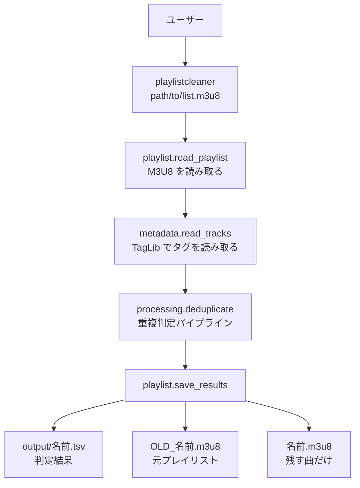
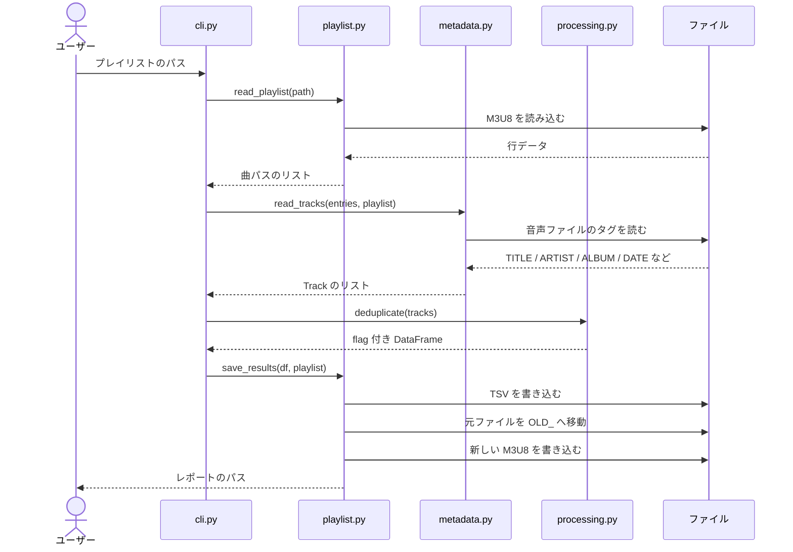
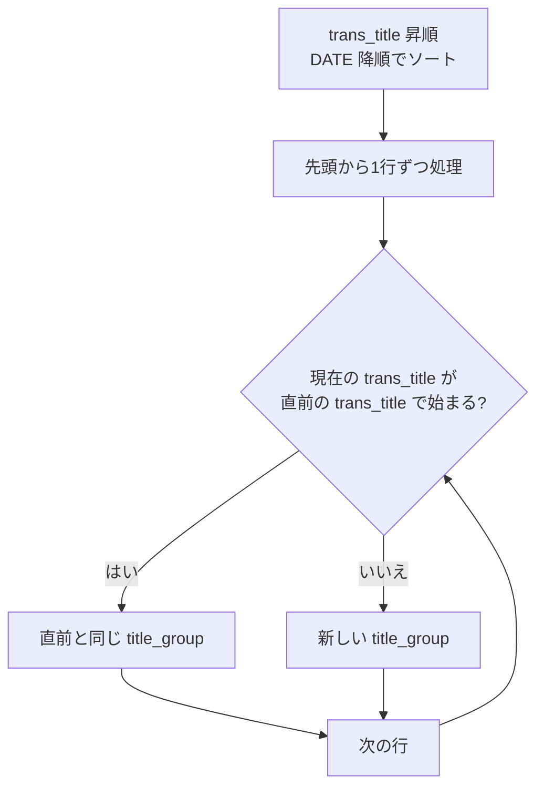
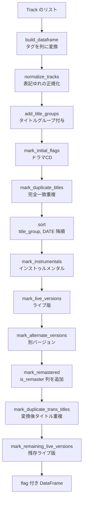
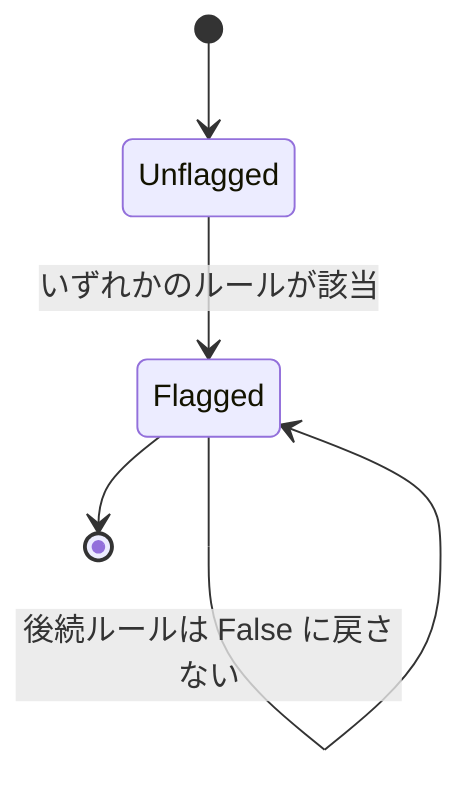
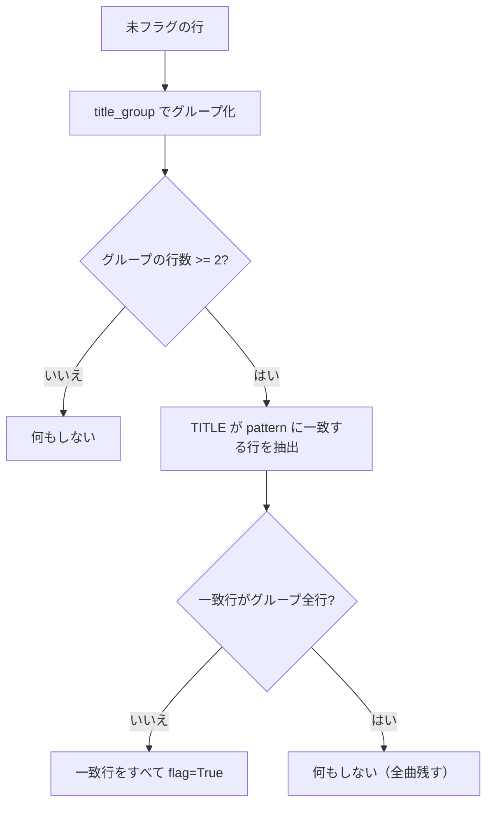
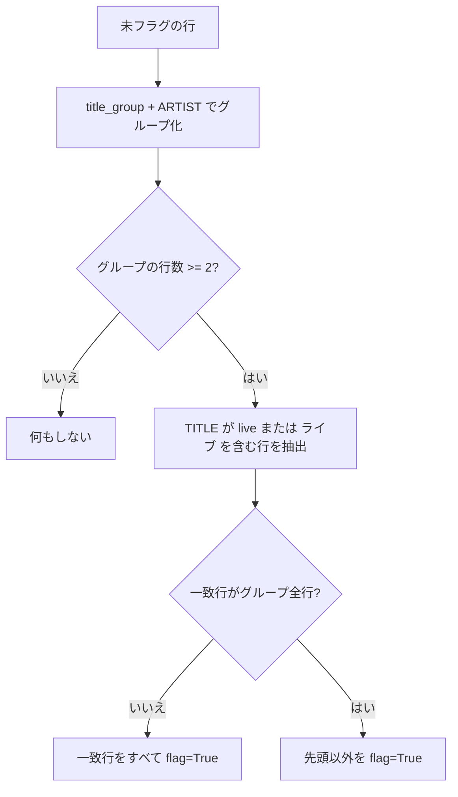
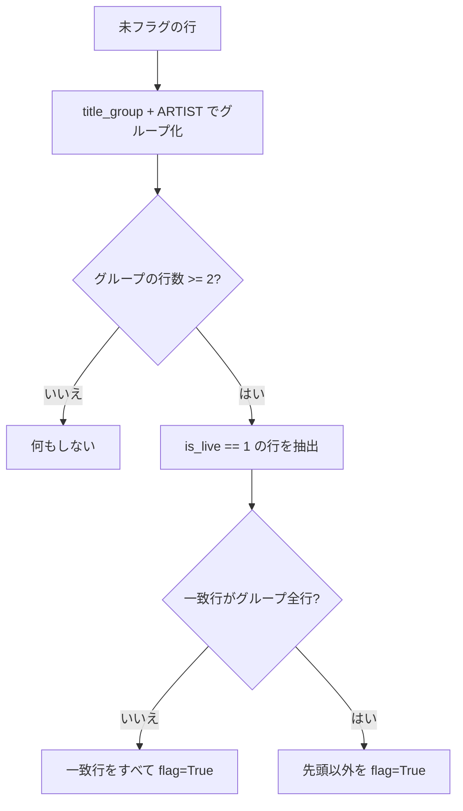
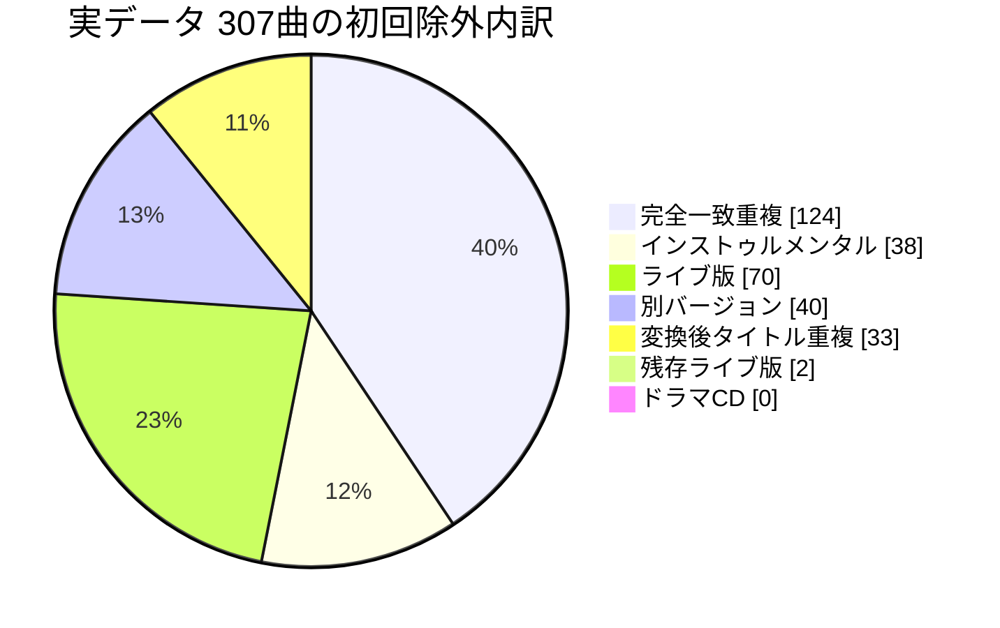
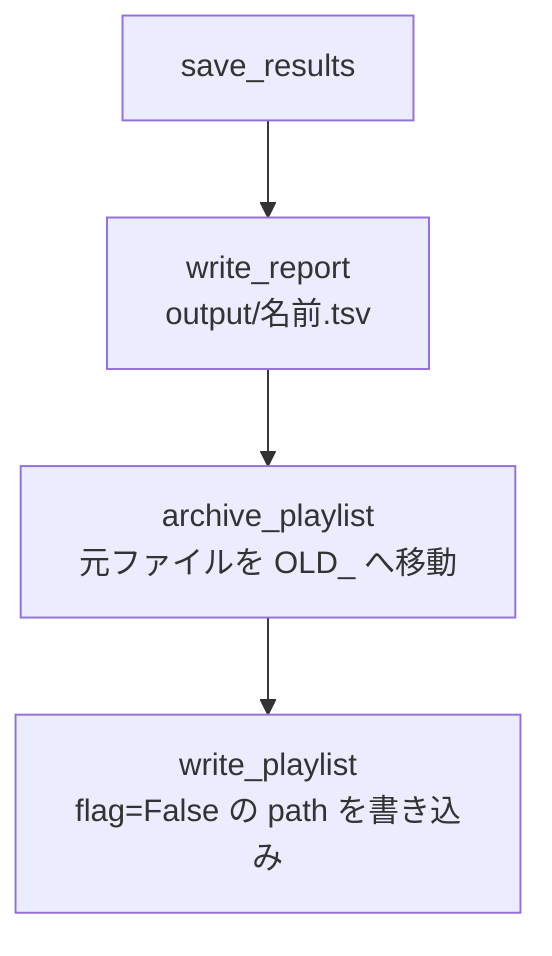

# 重複判定ロジックの現状

- 対象: `8a2dfc1` に A-1（ドラマCD判定）と A-5（正規表現の部分一致）の修正を適用した状態
- 対象データ: `test.m3u8`（586曲、UTF-8 BOM、CRLF）
- 目的: 現行実装の挙動を整理し、ロジック見直しの土台にする

> このドキュメントは「現状どう動いているか」の記録です。判定仕様として妥当かどうかの結論は含みません。
> 妥当性が疑われる箇所は [8. レビュー対象](#8-レビュー対象) に整理しています。

---

## 0. 要約

現行の判定は、次の6種類のルールを**上から順に適用**するパイプラインです。

1. ドラマCDを除外する
2. 正規化後にタイトルとアーティストが完全一致する曲を除外する
3. 同じタイトルグループ内のインストゥルメンタル版を除外する
4. 同じタイトルグループ・アーティスト内のライブ版を除外する
5. 同じタイトルグループ・アーティスト内の別バージョンを除外する
6. 変換後タイトルとアーティストが一致する曲を、優先順位に従って除外する

実データでは **586曲中307曲を除外し、279曲を残しました**。最も多いのは「タイトルとアーティストの完全一致」による124曲で、除外全体の約4割を占めます。

現状の主な確認点は以下です。

- ドラマCD判定は、正規化後の `ドラマcd` と比較するよう修正済み（A-1）
- インストゥルメンタル判定はアーティストを無視するため、別アーティストのボーカル版を理由にカラオケ版を除外し得る
- タイトルグループは「直前のタイトルを接頭辞として照合する」方式で、推移的でも同一曲の集合でもない
- `wo`、`ver`、`live` などの正規表現は ASCII トークン境界を要求するよう修正済み。`every`、`forever`、`olive` には一致しない（A-5）
- `DATE` は文字列のまま比較され、`YYYY` と `YYYY-MM-DD` が混在している
- 完全一致重複の判定だけはリマスター優先を持たず、後段の変換後タイトル重複とは優先順位が異なる

---

## 1. 全体フロー

### 1.1 処理の構成



### 1.2 実行シーケンス



### 1.3 入出力

| 種別 | パス | 内容 |
|---|---|---|
| 入力 | 任意の `.m3u8` | 1行1パス。`#` で始まる行と空行は無視 |
| 出力1 | `output/<プレイリスト名>.tsv` | 全曲のタグと判定結果 |
| 出力2 | `OLD_<プレイリスト名>.m3u8` | 元のプレイリストの退避 |
| 出力3 | `<プレイリスト名>.m3u8` | `flag=False` の曲だけを元の順序で再出力 |

- 出力ディレクトリの既定値は、**カレントディレクトリからの相対パス** `output/` です。
- 入力は `utf-8-sig`（UTF-8 BOM 可）として読みます。CP932 などの他のエンコーディングは想定していません。
- 出力は pandas の既定に従い UTF-8（BOM なし）です。

---

## 2. データモデル

### 2.1 `Track`

```python
@dataclass(frozen=True)
class Track:
    path: str
    tags: Mapping[str, str]
```

- `path`: プレイリストに記録するパス。通常はプレイリストからの相対パス、計算できない場合（Windows の異なるドライブなど）は絶対パス。
- `tags`: タグ名 → **最初の値**。値が空のタグは含めません。複数値のタグは2番目以降を捨てます。

### 2.2 DataFrame の列

| 列 | 生成元 | 意味 |
|---|---|---|
| `TITLE` | タグ | 正規化後のタイトル |
| `ARTIST` | タグ | 正規化後のアーティスト |
| `ALBUM` | タグ | 正規化後のアルバム |
| `DATE` | タグ | 年または日付。欠損時は `0000-00-00` |
| `path` | `Track.path` | プレイリストに記録するパス |
| `flag` | 各ルール | `True` = 除外、`False` = 残す |
| `is_live` | `mark_duplicate_titles` の前 | `ALBUM` が `come along` または `live` を含むなら1 |
| `trans_title` | `normalize_tracks` | バージョン表記を除いた比較用タイトル |
| `group_pattern` | `add_title_groups` | グループ判定に使った直前の `trans_title` |
| `title_group` | `add_title_groups` | タイトルグループ番号 |
| `is_remaster` | `mark_remastered` | `TITLE` が `remaster` または `aufwachen` を含むなら1 |

その他、音声ファイルに存在するタグ（`GENRE`、`TRACKNUMBER` など）はそのまま列になります。

### 2.3 行の取捨

`build_dataframe()` は、`ARTIST` と `ALBUM` の**両方が欠損**している行を DataFrame から落とします。

- 実データでは 586行すべてが残り、落ちた行はありません。
- 片方だけ欠損している行は残り、正規化時に空文字で埋められます。
- `TITLE` が欠損していても、`ARTIST` か `ALBUM` があれば残ります。この場合 `trans_title` は空文字になります。
- 落ちた行はレポートにも新しいプレイリストにも現れません。**入力から静かに消える**挙動です。

また、音声ファイルの読み取りに失敗した場合は、その時点で処理全体が中断します。部分的なレポートは作られません。

---

## 3. 正規化

### 3.1 `normalize_text()`

`ARTIST`、`TITLE`、`ALBUM` に適用されます。


置換対象の記号は次のとおりです。

```text
/ \ ^ $ * + ? . | ' " ・ , 、 。 ’
```

例:

| 入力 | 出力 |
|---|---|
| `Ａｒｔｉｓｔ` | `artist` |
| `Song (Live)` | `song (live)` |
| `Hello, World!` | `hello world!` |
| `ドラマCD` | `ドラマcd` |

- `!`、`&`、`#`、`%`、`:`、`;` は置換対象に含まれません。
- ハイフン、丸括弧、角括弧、波括弧はこの段階では残ります。
- `&` と `and`、`feat.` と `featuring` などの表記統一は行いません。

### 3.2 `simplify_title()`

`TITLE` から比較用の `trans_title` を作ります。


実データでの例:

| `TITLE` | `trans_title` |
|---|---|
| `First Luck -初めての幸運-` | `firstluck` |
| `First Luck ～初めての幸運～` | `firstluck` |
| `Paper Doll ~ This Could Be the Night` | `paperdoll` |
| `Mighty Smile (魔法の微笑)` | `mightysmile` |
| `Mighty Smile (魔法の微笑み)` | `mightysmile` |
| `Christmas Eve (English Version)` | `christmaseve` |
| `2000トンの雨 [2003 New Vocal Remix]` | `2000トンの雨` |
| `I Love You Part I` | `iloveyouparti` |
| `I Love You Part II` | `iloveyoupartii` |

この処理は「バージョン違いを同じ曲としてまとめる」ために働きますが、同時に**曲名の一部を情報として捨てています**。

- 括弧内が `Part 1` / `Part 2` のような意味のある区分でも除去されます。
- `-...-` や `~...~` の副題も除去されます。
- 入れ子の括弧は想定していません。`Song (Live (Remix))` のようなタイトルでは `)` が残る可能性があります。
- ハイフンは `-...-` の対で除去したあと、残った `-` もすべて除去されます。`x-y-z` は `xz` になります。
- ASCII のハイフン以外（en dash、em dash など）は除去対象外です。

---

## 4. タイトルグループ

### 4.1 目的

バージョン判定（インストゥルメンタル、ライブ、別バージョン）は、いきなり全曲を比較するのではなく、`title_group` という単位に分けてから比較します。

### 4.2 アルゴリズム



擬似コード:

```python
df = df.sort_values(["trans_title", "DATE"], ascending=[True, False])
patterns = roll(
    df["trans_title"].to_numpy(), 1
)  # 直前の trans_title。先頭行は最終行を参照
group = 0
for pattern, title in zip(patterns, df["trans_title"]):
    if not re.match("^" + re.escape(str(pattern)), title):
        group += 1
    df["title_group"] = group
    df["group_pattern"] = pattern
```

重要なのは、**比較対象が「直前の1行」だけ**という点です。

- 同じ `trans_title` の行はソート後に隣接するため、同じグループになります。
- 接頭辞関係が連続していれば同じグループになります。
- 途中に別のタイトルが挟まると、同じ接頭辞でも別グループになります。
- 逆に、別の曲でも接頭辞関係があれば同じグループになります。

### 4.3 実データでの例

**同じ接頭辞でも分割される例（過小統合）**

| `trans_title` | `group_pattern` | `title_group` |
|---|---|---|
| `you` | `yellowcab` | 159 |
| `youbelongtome` | `you` | 159 |
| `youbetterrun` | `youbelongtome` | 160 |
| `youmakemefeelbrandnew` | `youbetterrun` | 161 |
| `youreyes` | `youmakemefeelbrandnew` | 162 |

`you` と `youbetterrun` は接頭辞関係にありますが、間に `youbelongtome` が入るため別グループです。

**別の曲でも同じグループになる例（過大統合）**

| `trans_title` | `title_group` | 備考 |
|---|---|---|
| `angel` | 5 | 「Angel」 |
| `angelofthelight` | 5 | 「Angel of the Light」 |
| `angelswehaveheardonhigh` | 6 | 「Angels We Have Heard on High」 |
| `wind` | 157 | 「Wind」 |
| `windylady` | 157 | 「Windy Lady」 |
| `you` | 159 | 「You」 |
| `youbelongtome` | 159 | 「You Belong to Me」 |
| `いつか` | 165 | 「いつか」 |
| `いつか晴れた日に` | 165 | 「いつか晴れた日に」 |

`angel` と `angelswehaveheardonhigh` は同じ接頭辞ですが、間に `angelofthelight` が入るため別グループです。一方、`wind` と `windylady` は別曲ですが同じグループです。

### 4.4 性質と限界

- **推移的ではない**: `A` が `B` の接頭辞、`B` が `C` の接頭辞でも、`A` と `C` が同じグループになるとは限りません。
- **同一曲の集合ではない**: 接頭辞が同じ別曲を巻き込みます。
- **ソート順に依存**: 曲を追加・削除するとグループ番号と境界が変わります。同じ曲集合でも、別の曲が挟まるだけで判定結果が変わります。
- **先頭行の `group_pattern` は最終行のタイトル**: `roll` の仕様です。通常は一致しませんが、最終行が先頭行の接頭辞だと先頭行がグループ0になり得ます。
- **空の `trans_title`**: `re.match("^", title)` はすべてのタイトルに一致します。実データには空の `trans_title` はありませんが、タイトル欠損があると直後の行が同じグループに吸い込まれます。
- **グループ番号は安定したIDではない**: レポートの並び順に使われますが、曲の同一性を表すIDではありません。

---

## 5. 判定パイプライン

### 5.1 ステージ一覧



| 順序 | 関数 | 対象 | グループキー | 主な条件 | 実データの新規除外 |
|---:|---|---|---|---|---:|
| 1 | `mark_initial_flags` | 全行 | なし | `ARTIST == "ドラマCD"` | 0 |
| 2 | `mark_duplicate_titles` | 全行 | `TITLE`, `ARTIST` | 完全一致の2件目以降 | 124 |
| 3 | `mark_instrumentals` | 未フラグ行 | `title_group` | インストゥルメンタル表記 | 38 |
| 4 | `mark_live_versions` | 未フラグ行 | `title_group`, `ARTIST` | `live` / `ライブ` | 70 |
| 5 | `mark_alternate_versions` | 未フラグ行 | `title_group`, `ARTIST` | 別バージョン表記 | 40 |
| 6 | `mark_remastered` | 全行 | なし | `remaster` / `aufwachen` | 0（列追加のみ） |
| 7 | `mark_duplicate_trans_titles` | 全行 | `trans_title`, `ARTIST` | 変換後タイトルの一致 | 33 |
| 8 | `mark_remaining_live_versions` | 未フラグ行 | `title_group`, `ARTIST` | `is_live == 1` | 2 |

### 5.2 フラグの単調性



- `flag` は `False` から `True` にしか変わりません。一度除外された曲が後から復活することはありません。
- `mark_initial_flags` が最初に全行を `False` で初期化します。
- バージョン系のルールは `df[~df["flag"]]` を対象にするため、**先に除外された曲は後続の判定に参加しません**。
- `mark_duplicate_titles` と `mark_duplicate_trans_titles` は全行を対象にしますが、`True` を `False` に戻すことはありません。

このため、**ルールの適用順が最終結果を左右します**。同じ曲でも、先に別のルールで除外されると、後続ルールの「残す側」になれません。

### 5.3 各ステージの詳細

#### 5.3.1 `mark_initial_flags()` — ドラマCD

- 意図: `ARTIST` が `ドラマCD` の曲を除外する。
- 実装: `df["ARTIST"] == DRAMA_CD_ARTIST` で `flag=True`。
- `DRAMA_CD_ARTIST` は `normalize_text("ドラマCD")` で生成するため、`normalize_tracks()` 後の `ドラマcd` と一致します（A-1 修正済み）。
- 実データには `ARTIST` に「ドラマ」を含む曲がないため、除外は0件です。
- 統合テスト `test_deduplicate_flags_drama_cd_tracks` が、パイプライン全体を通してドラマCDが除外されることを検証します。

#### 5.3.2 `mark_duplicate_titles()` — 完全一致重複

- 並び替え: `TITLE` 昇順、`is_live` 昇順、`DATE` 降順
- 判定: `(TITLE, ARTIST)` の重複のうち、**並び替え後の2件目以降**を `flag=True`
- 残す優先順位:
  1. 非ライブ（`is_live=0`）
  2. `DATE` が新しい
  3. 同点なら元の入力順


実データ:

- 完全一致グループ: 89組
- グループサイズ: 2件が62組、3件が20組、4件が6組、5件が1組
- 同じアルバム内の重複: 2組
- 同じ `DATE` の重複: 5組
- 最終的にグループ全員が除外された完全一致グループ: 22組（ライブ版やカラオケ版が全滅し、別タイトルの通常版が残るケース）

例:

| `TITLE` | `ALBUM` | `DATE` | `is_live` | 結果 |
|---|---|---|---:|---|
| `bomber` | `opus ~all time best 1975-2012~ [disc 1]` | 2012 | 0 | 残す |
| `bomber` | `go ahead!` | 2002-01-01 | 0 | 除外 |
| `bomber` | `come along` | 1979 | 1 | 除外 |

注意点:

- `is_remaster` はこの時点ではまだ存在しません。**完全一致重複ではリマスター優先が働きません。**
- アルバム名は直接見ていません。`is_live` を通じてのみ間接的に影響します。
- 正規化後の `TITLE` が完全一致する必要があります。`Song` と `Song!` は別物です。
- 同じタイトル・アーティストでも、別録音・別演奏なら区別できません。音声指紋は使っていません。

#### 5.3.3 バージョン系ルールの前の並び替え

`mark_instrumentals` の前に、`title_group` 昇順、`DATE` 降順で並び替えます。

- 同じグループ内では、`DATE` が新しい曲が先頭になります。
- 後述の「全曲一致時に先頭を残す」ルールは、この並びの先頭を残します。
- `DATE` は文字列比較なので、`YYYY` と `YYYY-MM-DD` が混在すると単純な時系列になりません（[8.6](#86-date-が文字列で比較される)）。

#### 5.3.4 `mark_instrumentals()` — インストゥルメンタル版



- グループキー: `title_group` のみ。**`ARTIST` を含みません。**
- パターン（ASCII トークンは境界付き）: `instrumentals?` / `without vocals?` / `backing track` / `karaoke` / `inst` / `off vocal` / `vocalless` / `カラオケ` / `ヴォーカルレス`
- 一致する行がグループの一部なら、その行をすべて除外。
- 一致する行がグループ全行なら、**何も除外せず全曲残す**。

実データでは38曲を除外しました。主な例:

- `2000トンの雨 [karaoke]`
- `cheer up! the summer (original karaoke)`
- `circus town (original karaoke)`
- `endless game (original karaoke)`
- `windy lady [karaoke]`

注意点:

- アーティストを無視するため、別アーティストのボーカル版を理由にカラオケ版を除外できます。
  - 実例: グループ119で、山下達郎の `reborn (original karaoke)` が、セリ（門脇麦）の `reborn` を理由に除外されています。逆にセリ版のカラオケも、山下達郎の `reborn` を理由に除外されています。
- グループ全行がインストゥルメンタルなら全曲残ります。ライブ版・別バージョンは「全曲一致なら1曲残す」ので、**ルール間で挙動が不統一**です。
- `without vocals` / `backing track` に限定し、`inst` には境界を付けたため、`Without You` や `instant` には一致しません（A-5 修正済み）。
- 実データで最終的に残ったインストゥルメンタル表記の曲は2曲でした。いずれもグループに競合する通常版がいないためです。

#### 5.3.5 `mark_live_versions()` — ライブ版（タイトル基準）



- グループキー: `title_group` + `ARTIST`
- パターン: `live`（ASCII トークン境界付き）または `ライブ`
- 一部一致なら一致行をすべて除外。
- 全曲一致なら**先頭1曲を残し、残りを除外**。
- 先頭は、直前の `title_group` 昇順・`DATE` 降順の並びで決まります。

実データでは70曲を除外しました。主な例:

- `bella notte (2013 live version) [2013 12 19 at 大阪フェスティバルホール]`
- `bella notte (2019 live version) [2019 8 17 at 神奈川県民ホール]`
- `bella notte [live]`
- `candy [live]`
- `circus town [live]`
- `daydream [live]`

注意点:

- タイトルの `live` を見るだけで、アルバムの `is_live` は見ません。ライブアルバムでもタイトルに `live` がなければこのステージでは除外されません。
- `live` は ASCII トークン境界を要求するため、`olive`、`alive`、`delivery`、`outlive` には一致しません（A-5 修正済み）。
- 全曲一致時に残すのは「その時点の並びの先頭」であり、明確な「最良版」を選んでいるわけではありません。

#### 5.3.6 `mark_alternate_versions()` — 別バージョン

- グループキー: `title_group` + `ARTIST`
- パターン（ASCII トークンは前後が ASCII 英数字でないことを要求）:
  `tv` / `short` / `singles?` / `remix(?:es)?` / `mix(?:es)?` / `wo` / `edit(?:ed)?` / `ver` / `style` / `another` / `versions?` / `recordings?` / `reprise` / `mode` / `ヴァージョン` / `バージョン`
- 一部一致なら一致行をすべて除外。
- 全曲一致なら先頭1曲を残し、残りを除外。

実データでは40曲を除外しました。主な例:

- `2000トンの雨 [2003 new vocal remix]`
- `2000トンの雨 (2003 new vocal remix)`
- `blue midnight (1st mix)`
- `funky flushin [1982ヴァージョン]`
- `i love you [acappella 120sec version]`
- `inserted songs into let s dance baby (2012 グループ サウンズ version)`
- `reborn (harmonica version)`
- `the girl in white (early version)`
- `white christmas (happy xmas show! version)`

注意点:

- ASCII トークンは前後が ASCII 英数字でない場合だけ一致するため、`every`、`forever`、`never`、`overture`、`world`、`wonder`、`lover` の中の `ver` / `wo` には一致しません（A-5 修正済み）。
  - 修正前は `every night [2012 new remaster]` が `every` の中の `ver` に、`forever mine` が `forever` の中の `ver` に、`joy to the world` が `world` の中の `wo` に一致していました。
  - 実データでは、これらの曲に競合する未フラグ曲がいなかったため最終結果は変わりませんでした。修正後も除外307曲・残存279曲は同じです。
- 日本語トークン（`ヴァージョン`、`バージョン`、`カラオケ`、`ライブ` など）には ASCII 境界を付けないため、`1982ヴァージョン` のように数字の直後にある表記にも一致します。
- `single`、`another`、`style`、`mode` は曲名の一部としても現れ得ます。
- 全曲一致時に残すのは、その時点の並びの先頭です。

#### 5.3.7 `mark_remastered()` — リマスター列

- `TITLE` が `remaster` / `remastered` / `aufwachen`（ASCII トークン境界付き）を含む場合に `is_remaster=1`。
- このステージ自体は `flag` を変更しません。
- `is_remaster` は後続の `mark_duplicate_trans_titles` の並び替えでのみ使われます。
- `aufwachen` は現行コードにのみ存在する指定で、意図はコードから読み取れません。実データには該当曲がありません。
- アルバム名の `remaster` は見ません。タイトルに `remaster` がないリマスター盤は `is_remaster=0` です。

#### 5.3.8 `mark_duplicate_trans_titles()` — 変換後タイトル重複

- 並び替え: `trans_title` 昇順、`flag` 昇順、`is_remaster` 降順、`is_live` 昇順、`DATE` 降順
- 判定: `(trans_title, ARTIST)` の重複のうち、**並び替え後の2件目以降**を `flag=True`


実データでは33曲を除外しました。主な例:

| 残す曲 | 除外する曲 | 決め手 |
|---|---|---|
| `donut song (2023 new remaster)` | `donut song`（1998） | リマスター優先 |
| `get back in love (2020 remaster)` | `get back in love`（1988） | リマスター優先 |
| `lady blue (2020 remaster)` | `lady blue`（1991） | リマスター優先 |
| `mermaid (2020 remaster)` | `mermaid`（1991） | リマスター優先 |
| `the girl in white (2020 remaster)` | `the girl in white`（1988） | リマスター優先 |
| `juvenile のテーマ ~瞳の中のrainbow~`（非ライブ） | 同名のライブ版 | 非ライブ優先 |
| `love talkin (honey it's you)`（非ライブ） | `love talkin`（ライブ） | 非ライブ優先 |
| `いつか (someday)`（非ライブ） | `いつか`（ライブ） | 非ライブ優先 |
| `silent night`（2013） | `silent night (聖夜)`（1986） | DATE 優先 |
| `クリスマス・イブ`（2025） | `クリスマス・イブ (key in d)`（2013） | DATE 優先 |

注意点:

- `flag` が `is_remaster` より優先されます。つまり、**すでに除外済みのリマスター版は復活しません**。
- `trans_title` が同じになるのは、`simplify_title` が括弧・副題・バージョン表記を落とした結果です。別曲が同じ `trans_title` になる可能性があります。
- `DATE` は文字列比較です。`YYYY` と `YYYY-MM-DD` が混在すると、意図した新旧比較になりません。
- このステージは全行を対象にしますが、`flag=True` の行を `False` に戻すことはありません。

#### 5.3.9 `mark_remaining_live_versions()` — 残存ライブ版



- グループキー: `title_group` + `ARTIST`
- 条件: `is_live == 1`（アルバム名が `come along` または `live` を含む）
- 一部一致なら一致行をすべて除外。
- 全曲一致なら先頭1曲を残し、残りを除外。

実データでは2曲を除外しました。

- `paper doll ~ this could be the night`（アルバム `come along`）
- `ついておいでよ (follow me along) ~蛍の光`（アルバム `come along`）

注意点:

- タイトルではなくアルバム由来の `is_live` を使います。
- グループ内に別の未フラグ曲が1曲でもあれば、ライブ版は除外されます。その曲が同じ曲の別バージョンとは限りません（`title_group` の限界）。
- 全曲一致時に残すのは、前ステージまでの並び順の先頭です。`mark_duplicate_trans_titles` の並び（`trans_title`、`flag`、`is_remaster`、`is_live`、`DATE`）に依存します。

### 5.4 残す・除外するのまとめ

| ルール | グループキー | 残すもの | 除外するもの |
|---|---|---|---|
| 完全一致重複 | `TITLE`, `ARTIST` | 非ライブ → 新しい `DATE` → 入力順の先頭 | それ以外の重複 |
| インストゥルメンタル | `title_group` | 一致しない行。全行一致なら全曲 | 一致する行（全行一致を除く） |
| ライブ版 | `title_group`, `ARTIST` | 一致しない行。全行一致なら先頭1曲 | 一致する行（全行一致なら先頭以外） |
| 別バージョン | `title_group`, `ARTIST` | 一致しない行。全行一致なら先頭1曲 | 一致する行（全行一致なら先頭以外） |
| 変換後タイトル重複 | `trans_title`, `ARTIST` | 未フラグ → リマスター → 非ライブ → 新しい `DATE` の先頭 | それ以外の重複 |
| 残存ライブ版 | `title_group`, `ARTIST` | 非ライブの行。全行ライブなら先頭1曲 | ライブの行（全行ライブなら先頭以外） |

### 5.5 実データでの除外内訳



| ステージ | 新規除外 | 累計除外 |
|---|---:|---:|
| `mark_initial_flags` | 0 | 0 |
| `mark_duplicate_titles` | 124 | 124 |
| `mark_instrumentals` | 38 | 162 |
| `mark_live_versions` | 70 | 232 |
| `mark_alternate_versions` | 40 | 272 |
| `mark_remastered` | 0 | 272 |
| `mark_duplicate_trans_titles` | 33 | 305 |
| `mark_remaining_live_versions` | 2 | 307 |

### 5.6 最終的に残った曲

- 残存: 279曲
- `is_live=1` の残存: 13曲
- タイトルに `live` を含む残存: 24曲
- インストゥルメンタル表記の残存: 2曲
- 別バージョン表記の残存: 15曲
- リマスター表記の残存: 21曲

ルールは「競合する未フラグ曲がいる場合」だけ発動するため、**その曲種しか存在しない場合は残ります**。たとえば、ある曲にライブ版しかなく、同じ `title_group` に通常版がなければ、ライブ版は残ります。これは意図的な挙動と考えられますが、`title_group` が別曲を巻き込んでいる場合は意図しない残存・除外につながります。

---

## 6. 出力

### 6.1 判定結果 TSV

`write_report()` は `output/<プレイリスト名>.tsv` を出力します。

- 列の順序: `TITLE`、`ARTIST`、`ALBUM`、`flag`、`trans_title`、`title_group`、その他のタグ、内部列（`path`、`is_live`、`group_pattern`、`is_remaster`）
- 並び順: `title_group` 昇順、`flag` 昇順（同じグループ内では残す曲が先）
- `flag` は `True` / `False` の文字列として出力
- DataFrame の index も列として出力されるため、先頭に**名前のない列**が付きます。読み戻すと `Unnamed: 0` になります。

実データのヘッダー先頭:

```text
	TITLE	ARTIST	ALBUM	flag	trans_title	title_group	DATE	...
```

### 6.2 新しいプレイリスト

`write_playlist()` は元のプレイリストパスに、`flag=False` の曲だけを書き込みます。

- `df.sort_index()` で**入力時の順序**に戻してから書き込みます。
- 出力する列は `path` のみ。
- タブ区切り、ヘッダーなし、index なし。
- 出力順はレポートの `title_group` 順ではなく、元のプレイリスト順です。

### 6.3 元プレイリストの退避

`archive_playlist()` は `shutil.move()` で `OLD_<名前>` に移動します。

- `OLD_` が既に存在する場合の挙動は OS に依存します。Windows では `FileExistsError` になり得ます。
- 同じプレイリストに対して2回実行すると、2回目の退避で失敗する可能性があります。

### 6.4 保存の順序



- レポート作成 → 元ファイル退避 → 新プレイリスト書き込み、の順です。
- トランザクションではありません。途中で失敗すると、レポートだけ更新された、元ファイルだけ退避された、といった中間状態になり得ます。
- 元ファイルは `OLD_` に残るため、新プレイリストの書き込みに失敗しても復旧は可能です。

### 6.5 パスの扱い

- 入力パスが相対なら、プレイリストのディレクトリを基準に `resolve(strict=True)` します。存在しないファイルはエラーになります。
- 出力パスは、通常はプレイリストのディレクトリからの相対パスです。
- `relpath()` が `ValueError` を出す場合（Windows で異なるドライブなど）だけ、絶対パスを記録します。
- Unix では異なるマウント間でも `relpath()` が例外を出さないため、通常は相対パスのままです。

---

## 7. 実データでの結果

### 7.1 基本集計

| 項目 | 値 |
|---|---:|
| 入力エントリ数 | 586 |
| タグ読み取り成功 | 586 |
| DataFrame 行数 | 586 |
| 欠落タグで落ちた行 | 0 |
| 除外 | 307 |
| 残存 | 279 |
| タイトルグループ数 | 271 |
| 除外が1曲もないグループ | 140 |
| 全曲除外されたグループ | 0 |
| 出力プレイリストの順序 | 入力順と一致 |

### 7.2 タイトルグループのサイズ

| グループサイズ | グループ数 |
|---:|---:|
| 1 | 137 |
| 2 | 62 |
| 3 | 27 |
| 4 | 18 |
| 5 | 10 |
| 6 | 7 |
| 7 | 5 |
| 8 | 2 |
| 9 | 2 |
| 11 | 1 |

### 7.3 日付の形式

| 形式 | 件数 |
|---|---:|
| `YYYY` | 322 |
| `YYYY-MM-DD` | 264（うち欠損の `0000-00-00` が1件） |

### 7.4 検証済みのこと

- リファクタリング前後（`8005ce8` と `aa8b223`）で、実プレイリストの出力がバイト単位で一致
- Windows でプレイリストが `C:`、音楽が `E:` にある場合も、絶対パスへのフォールバックで実行可能
- Ubuntu CI で lint、型チェック、テスト、セキュリティ検査が成功
- A-1 / A-5 の修正前後で、実プレイリストの最終結果（除外307曲・残存279曲）が一致
- A-5 の修正により、`ALTERNATE_VERSION_PATTERN` の誤一致9種類（`every night`、`forever mine`、`joy to the world` など）が解消

---

## 8. レビュー対象

以下は「現状の挙動」から見えた確認候補です。優先度は、実データへの影響と修正のしやすさで暫定分類しています。
A-1 と A-5 は修正済みで、残る項目が検討対象です。

### 8.1 優先度A: 判定結果に直接影響し得る

#### A-1. ドラマCD判定が実質無効（修正済み）

- 原因: `normalize_text()` の小文字化と、`mark_initial_flags()` の `"ドラマCD"` 定数の不一致。
- 修正: `DRAMA_CD_ARTIST = normalize_text("ドラマCD")` を導入し、正規化後の `ARTIST`（`ドラマcd`）と比較する。
- テスト: `test_mark_initial_flags_flags_drama_cds` を正規化後の入力に変更し、`test_deduplicate_flags_drama_cd_tracks` でパイプライン全体を通した除外を検証する。
- 実データへの影響: ドラマCDが存在しないため、除外0件のまま。

#### A-2. インストゥルメンタル判定がアーティストを無視

- 原因: `mark_instrumentals()` のグループキーが `title_group` のみ。
- 影響: 別アーティストのボーカル版を理由に、カラオケ版が除外され得る。
- 実例: `reborn` グループ（山下達郎とセリ）。
- 確認: カラオケ・インストゥルメンタルはアーティストをまたいで除外すべきか。

#### A-3. 全曲一致時の扱いがルールごとに不統一

- インストゥルメンタル: 全曲一致なら全曲残す。
- ライブ版・別バージョン: 全曲一致なら先頭1曲残す。
- 影響: カラオケしかない曲は全曲残り、ライブしかない曲は1曲だけ残る。
- 確認: どちらに統一するか。あるいは「通常版が存在しない場合は残す」という共通仕様にするか。

#### A-4. タイトルグループが推移的でない

- 原因: 直前の1行との接頭辞比較のみ。
- 影響: 同じ接頭辞の曲が分割されたり、別曲が同じグループになったりする。
- 実例:
  - 分割: `you` と `youbetterrun`、`angel` と `angelswehaveheardonhigh`
  - 併合: `wind` と `windylady`、`you` と `youbelongtome`、`angel` と `angelofthelight`
- 確認: グループを「共通接頭辞のクラスタ」にするか、類似度（編集距離・トークン）にするか、あるいは曲ごとの明示的な関連付けにするか。

#### A-5. 正規表現が部分一致する（修正済み）

- 原因: `wo`、`ver`、`tv`、`mix`、`live`、`inst`、`without` などに単語境界がない。
- 修正:
  - `_token()` を追加し、ASCII トークンの前後が ASCII 英数字でないことを要求する。
  - `_token()` は ASCII トークンにだけ適用し、`ヴァージョン`、`バージョン`、`カラオケ`、`ライブ` などの日本語トークンには適用しない（`1982ヴァージョン` のような表記を維持するため）。
  - `remastered`、`edited`、`singles`、`remixes`、`recordings` などの活用形を明示的に許可する。
  - `without` / `backing` は VBS と同じく `without vocals` / `backing track` に限定する。
- 検証: `every night`、`forever mine`、`never grow old`、`overture`、`joy to the world`、`please let me wonder`、`secret lover` など9種類の誤一致が消えた。
- 実データへの影響: 誤一致した曲に競合曲がいなかったため、除外307曲・残存279曲は変わらない。
- 残る論点: `single`、`another`、`style`、`mode` は曲名の一部としても現れ得る。境界だけでは防げないため、必要ならバージョン表記の位置（括弧内など）で絞る。

### 8.2 優先度B: 判定の一貫性・説明可能性

#### B-1. `DATE` が文字列で比較される

- `YYYY` と `YYYY-MM-DD` が混在（322件 / 264件）。
- 文字列の降順では `2021-01-01` が `2021` より新しく扱われる。
- 同年の年のみ表記が、実際の日付より古く扱われる可能性がある。
- `DATE` は完全一致重複、タイトルグループ、ライブ版・別バージョンの先頭選択、変換後タイトル重複、残存ライブ版のすべてに影響する。
- 確認: 年のみの値をどう解釈するか（1月1日、12月31日、不明として最後、など）。

#### B-2. 完全一致重複だけリマスター優先を持たない

- `mark_duplicate_titles()` は `is_remaster` ができる前に実行される。
- `TITLE` が完全一致する場合は、リマスターより新しい通常版が優先され得る。
- `mark_duplicate_trans_titles()` ではリマスターが優先される。
- 実データでは完全一致グループにリマスター差がなかったため未発現。
- 確認: リマスター優先を全ステージで統一するか。

#### B-3. `simplify_title()` が情報を落としすぎる可能性

- 括弧・角括弧・波括弧・ハイフン対・チルダ対の内容をすべて除去。
- `Part 1` / `Part 2` や副題も消える。
- 入れ子の括弧、ASCII 以外のダッシュ、`!` や `&` などの記号は未対応。
- 実データでは `first luck`、`paper doll`、`mighty smile` などが統合されている。これらが同一曲なら意図どおりだが、別曲なら誤り。
- 確認: どの副題を「バージョン表記」とみなし、どれを曲名の一部として残すか。

#### B-4. ルールの適用順と「未フラグ行だけを見る」挙動

- 先に除外された曲は、後続ルールの比較対象になりません。
- 例えば、通常版が先に別ルールで除外されると、ライブ版が「グループに1曲しかいない」とみなされて残ることがあります。
- `mark_duplicate_trans_titles()` は `flag` を最優先するため、すでに除外されたリマスター版は復活しません。
- 確認: ルールを並列に評価して最後に優先順位で決めるか、現在の逐次適用を維持するか。

#### B-5. 出力契約がデバッグ寄り

- レポートに名前のない index 列が付く。
- 内部列（`is_live`、`group_pattern`、`is_remaster`）が公開される。
- タグ列の順序は最初の曲のタグ順に依存する。
- 確認: レポートを安定した公開スキーマにするか、デバッグ用と割り切るか。

### 8.3 優先度C: 堅牢性・運用

#### C-1. タグ欠損・タグ名の大文字小文字

- `TITLE` / `ARTIST` / `ALBUM` / `DATE` を大文字のキーで期待。
- タグ名が小文字・別名だと、必須列が NaN になり、`ARTIST` と `ALBUM` の両方が欠損すると行ごと落ちる。
- `TITLE` だけ欠損すると `trans_title` が空になり、グループ化に影響する。
- 確認: タグ名の正規化・エイリアス対応を行うか。

#### C-2. 1ファイルのエラーで全体が止まる

- 存在しないファイル、壊れたタグ、権限エラーなどで処理全体が中断。
- 部分的なレポートも作られない。
- 確認: エラー曲を記録して続行するか、現状のフェイルファストを維持するか。

#### C-3. `OLD_` の衝突と非トランザクション

- `OLD_` が既にあると、Windows では退避に失敗し得る。
- レポート更新後に退避が失敗すると、レポートだけ新しい状態になる。
- 確認: 上書き・タイムスタンプ付与・事前チェックのどれにするか。

#### C-4. 入力形式の前提

- UTF-8 BOM 前提。CP932 は非対応。
- URL エントリ（`http://...`）はローカルパスとして扱われ、失敗する。
- Windows の `E:\...` パスを Unix で読むと、バックスラッシュがパス区切りにならず失敗する。
- 行頭 `#` のファイルパスはコメントとして無視される。
- 確認: 対応する入力形式をどこまで広げるか。

#### C-5. 出力のエンコーディング・クォート

- 出力は UTF-8 BOM なし。元が BOM 付きでも BOM は失われる。
- pandas の CSV クォートにより、パスに引用符やタブが含まれるとクォートされる可能性がある。
- 確認: M3U8 の読み手が BOM やクォートをどう扱うか。

#### C-6. dry-run がない

- `run()` は必ずレポート出力・退避・新プレイリスト書き込みまで行う。
- 判定だけ確認してから適用することができない。
- 確認: `--dry-run` や `--report-only` を設けるか。

---

## 9. 用語

| 用語 | 意味 |
|---|---|
| 完全一致重複 | 正規化後の `TITLE` と `ARTIST` が一致する重複 |
| 変換後タイトル重複 | `simplify_title()` 後の `trans_title` と `ARTIST` が一致する重複 |
| タイトルグループ | `trans_title` の接頭辞関係でまとめたグループ |
| ライブ版（タイトル） | `TITLE` に `live` または `ライブ` を含む曲 |
| ライブ版（アルバム） | `ALBUM` に `come along` または `live` を含む曲（`is_live=1`） |
| 別バージョン | `ALTERNATE_VERSION_PATTERN` に一致する曲 |
| インストゥルメンタル | `INSTRUMENTAL_PATTERN` に一致する曲 |
| リマスター | `TITLE` に `remaster` / `remastered` / `aufwachen` を含む曲 |

---

## 10. 付録

### 10.1 パターン一覧

ASCII のトークンには `_token()` により `(?<![a-z0-9_])…(?![a-z0-9_])` が付きます。日本語のトークンには付けません。

| 定数 | トークン | 適用先 |
|---|---|---|
| `LIVE_ALBUM_PATTERN` | `come along`, `live` | `ALBUM` |
| `LIVE_TITLE_PATTERN` | `live`, `ライブ` | `TITLE` |
| `INSTRUMENTAL_PATTERN` | `instrumentals?`, `without vocals?`, `backing track`, `karaoke`, `inst`, `off vocal`, `vocalless`, `カラオケ`, `ヴォーカルレス` | `TITLE` |
| `ALTERNATE_VERSION_PATTERN` | `tv`, `short`, `singles?`, `remix(?:es)?`, `mix(?:es)?`, `wo`, `edit(?:ed)?`, `ver`, `style`, `another`, `versions?`, `recordings?`, `reprise`, `mode`, `ヴァージョン`, `バージョン` | `TITLE` |
| `REMASTER_PATTERN` | `remaster(?:ed)?`, `aufwachen` | `TITLE` |

### 10.2 パイプライン擬似コード

```python
def deduplicate(tracks):
    df = build_dataframe(tracks)
    df = normalize_tracks(df)
    df = add_title_groups(df)
    df = mark_initial_flags(df)
    df = mark_duplicate_titles(df)
    df = df.sort_values(["title_group", "DATE"], ascending=[True, False])
    df = mark_instrumentals(df)
    df = mark_live_versions(df)
    df = mark_alternate_versions(df)
    df = mark_remastered(df)
    df = mark_duplicate_trans_titles(df)
    return mark_remaining_live_versions(df)
```

### 10.3 実データ集計の条件

- 入力: `test.m3u8`（586曲、UTF-8 BOM、CRLF）
- 音楽ファイル: `E:\SynologyDrive\music` 配下
- Python 3.12、pandas 3.1.1、pytaglib、numpy、tqdm
- 集計は `processing.py` の各ステージを順に適用し、ステージごとの `flag` の差分を数えたもの
- 「新規除外」は、そのステージで初めて `flag=True` になった曲数
